# Set up and manage your Content AI Sources

This guide walks you through setting up Content AI Sources in Cloud Manager - from meeting prerequisites to creating a content source and confirming it is indexed and available.

## Prerequisites {#prerequisites}

Before you begin, ensure the following conditions are met:

* You have an active Cloud Manager program with at least one AEM as a Cloud Service environment.
* You have a Cloud Manager product profile and can sign in to Cloud Manager - see [Get access to Cloud Manager](#cloud-manager-access) below.
* Your user is assigned to the **AEM Users** product profile for the target environment, which lets the user view content sources.
* Your user is assigned to the **AEM Administrators** product profile for the target environment, which lets the user create and edit content sources. Access to Cloud Manager alone is not sufficient - see [Assign a user to an AEM product profile](#assign-product-profile) below.
* The environment product profile has been provisioned in **Adobe Admin Console**.

## Get access to Cloud Manager {#cloud-manager-access}

To open the **[!UICONTROL Content AI Configuration]** tab, you need access to the Cloud Manager UI. Your organization's [!DNL Adobe Admin Console] administrator (system administrator or product administrator) grants this access.

1. Contact your [[!DNL Adobe Admin Console]](https://adminconsole.adobe.com/) administrator. If you are not yet a member of the organization, ask the administrator to add your Adobe ID or email address.
1. Ask the administrator to assign you a Cloud Manager product profile for the organization's AEM as a Cloud Service program:

   | Product profile | What it allows |
   | --- | --- |
   | **[!UICONTROL Business Owner]** | Manages programs. Has broad Cloud Manager permissions, including **[!UICONTROL Manage Access]**. |
   | **[!UICONTROL Deployment Manager]** | Manages environments, deployments, and pipelines. |
   | **[!UICONTROL Program Manager]** | Manages team setup and program oversight. |
   | **[!UICONTROL Developer]** | Works with code and Git. Has limited Cloud Manager permissions. |

1. To open Cloud Manager, sign in at [Cloud Manager](https://my.cloudmanager.adobe.com/) or go to [[!DNL Adobe Experience Cloud]](https://experience.adobe.com/) > **[!DNL Experience Manager]** > **[!UICONTROL Cloud Manager]**. If your Adobe ID belongs to more than one organization, select the correct organization.

>[!NOTE]
>
>A Cloud Manager product profile does not give access to content sources. You also need the **[!UICONTROL AEM Users]** or **[!UICONTROL AEM Administrators]** product profile for the environment - see [Assign a user to an AEM product profile](#assign-product-profile). A user with only the default Cloud Manager user role can open an environment but does not get program-level access.

If you sign in but cannot see the program or the **[!UICONTROL Content AI Configuration]** tab, ask your administrator to verify your assigned product profiles. Also confirm that you selected the correct organization at sign-in. AEM Managed Services uses a different [!DNL Admin Console] product context and setup than AEM as a Cloud Service.

To create programs during initial onboarding, the system administrator must first have the **[!UICONTROL Business Owner]** profile and sign in to Cloud Manager.

For more information, see:

* [Assign team members to Cloud Manager product profiles](https://experienceleague.adobe.com/en/docs/experience-manager-cloud-service/content/onboarding/journey/assign-profiles-cloud-manager)
* [Access Cloud Manager](https://experienceleague.adobe.com/en/docs/experience-manager-cloud-service/content/onboarding/journey/cloud-manager)
* [AEM as a Cloud Service team and product profiles](https://experienceleague.adobe.com/en/docs/experience-manager-cloud-service/content/onboarding/concepts/aem-cs-team-product-profiles)
* [Add users and roles](https://experienceleague.adobe.com/en/docs/experience-manager-cloud-manager/content/requirements/users-and-roles)

## Assign a user to an AEM product profile {#assign-product-profile}

Use this procedure to grant a user access to [!DNL Adobe Experience Manager] as a Cloud Service for a specific environment. Assign the profile that matches the access the user needs:

* **[!UICONTROL AEM Users]** - view content sources.
* **[!UICONTROL AEM Administrators]** - create and edit content sources.

>[!NOTE]
>
>Users must belong to an AEM product profile such as **[!UICONTROL AEM Users]** or **[!UICONTROL AEM Administrators]** to access AEM. Access to Cloud Manager alone is not sufficient.

To assign these profiles, you must be a system administrator with the [!UICONTROL Business Owner] Cloud Manager product profile. Have the user's name and email address ready.

1. In [Cloud Manager](https://my.cloudmanager.adobe.com/), navigate to your program and select **[!UICONTROL Manage Access]** for the target environment. A new tab opens [!DNL Adobe Admin Console] for that environment.
1. Select the **[!UICONTROL AEM Users]** or **[!UICONTROL AEM Administrators]** product profile for both the **author** and **publish** tiers - for example, `AEM Administrators - author - Program 12345 - Environment 67890` and `AEM Administrators - publish - Program 12345 - Environment 67890`.
   * **[!UICONTROL AEM Users]** - read-only operations.
   * **[!UICONTROL AEM Administrators]** - write operations, such as creating, editing, or removing a content source, and triggering acquisition.
1. Select **[!UICONTROL Add User]**.
1. Enter the user's name and email address, then save the change. The user is added to the product profile.

Repeat these steps for each environment where the user needs access, such as development, staging, or production.

>[!CAUTION]
>
>Do not edit or delete the default product profiles named **[!UICONTROL AEM Administrators]** or **[!UICONTROL AEM Users]**. Renaming **[!UICONTROL AEM Administrators]** removes administrator rights from everyone assigned to it.

### Verify the assignment {#verify-assignment}

To verify that the assignment succeeded:

1. In [!DNL Admin Console], reopen the product profile you assigned.
1. Confirm that the user appears in the member list.

If you are troubleshooting access or token issues, confirm that the user is added directly to the product profile and not only through a group.

## Step 1 - Open the Content AI Configuration Tab {#open-tab}

1. Sign in to [Cloud Manager](https://my.cloudmanager.adobe.com/) and select your program.

   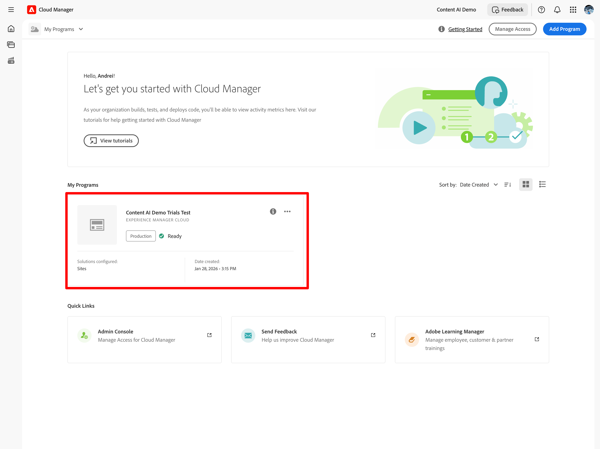

1. From the **[!UICONTROL Program Overview]**, locate the **[!UICONTROL Environments]** section and select the environment you want to configure.

   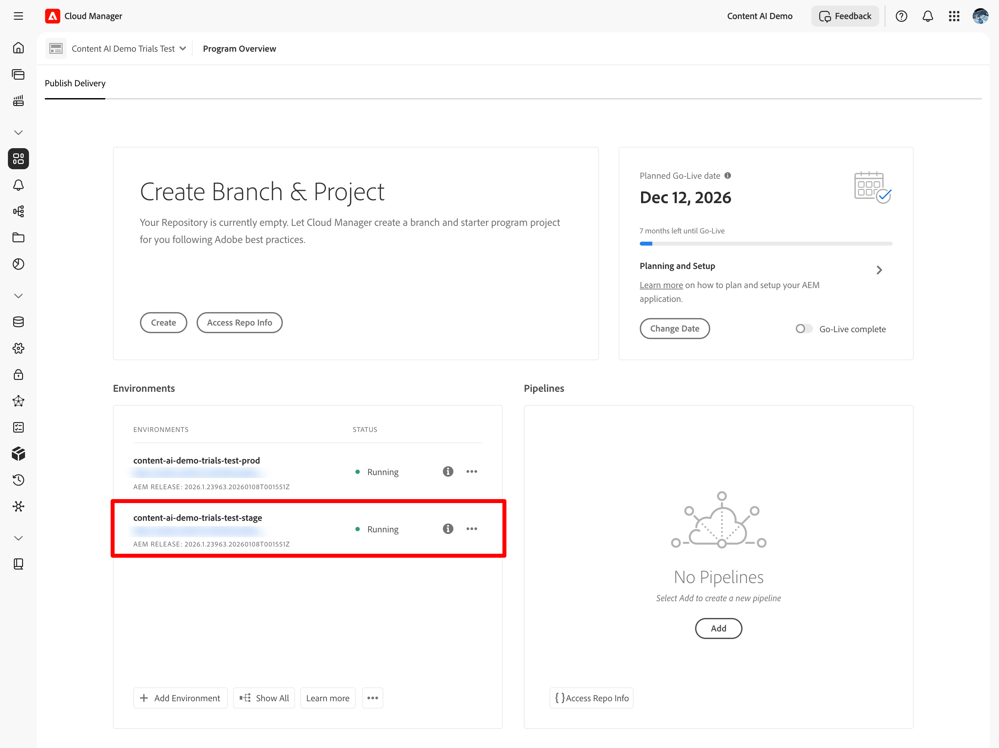

1. On the environment detail page, select the **[!UICONTROL Content AI Configuration]** tab.

   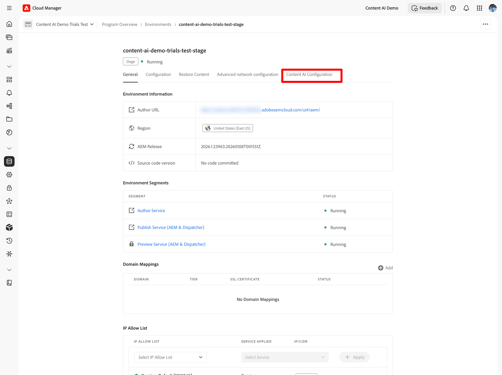

## Step 2 - Create a Content AI Source {#create-source}

A content source defines the website that Content AI crawls and indexes.

1. On the **[!UICONTROL Content AI Configuration]** tab, select **[!UICONTROL Create Source]**.

   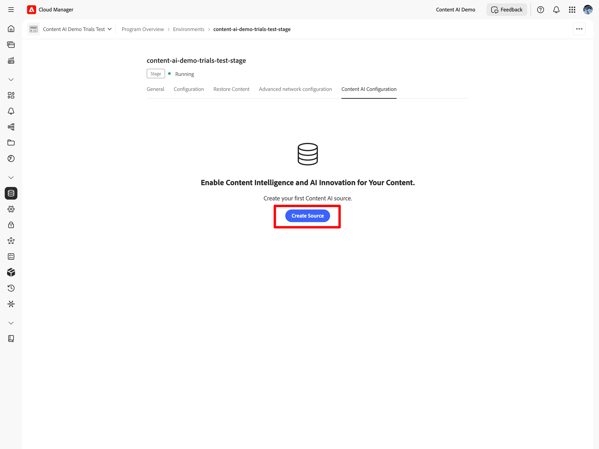

1. In the **[!UICONTROL Create/Add new Content AI Source]** dialog, fill in the fields:

   | Field | Description |
   | --- | --- |
   | **[!UICONTROL Content AI Configuration Name]** | A unique identifier for this source (for example, `my-site-index`). Cannot be changed after creation. |
   | **[!UICONTROL Description]** | *(Optional)* A short description of the content source. |
   | **[!UICONTROL Website address]** | The root URL of the website to crawl (for example, `https://www.example.com/`). |
   | **[!UICONTROL Exclude URLs]** | *(Optional)* URL patterns to skip during crawling. |
   | **[!UICONTROL Refresh frequency]** | How often Content AI re-crawls the source: Weekly, Daily, Daily 4×, 60 Min, or 15 Min. |

   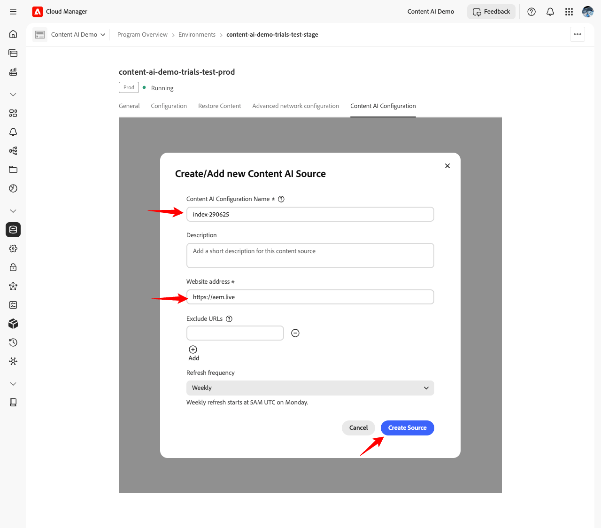

   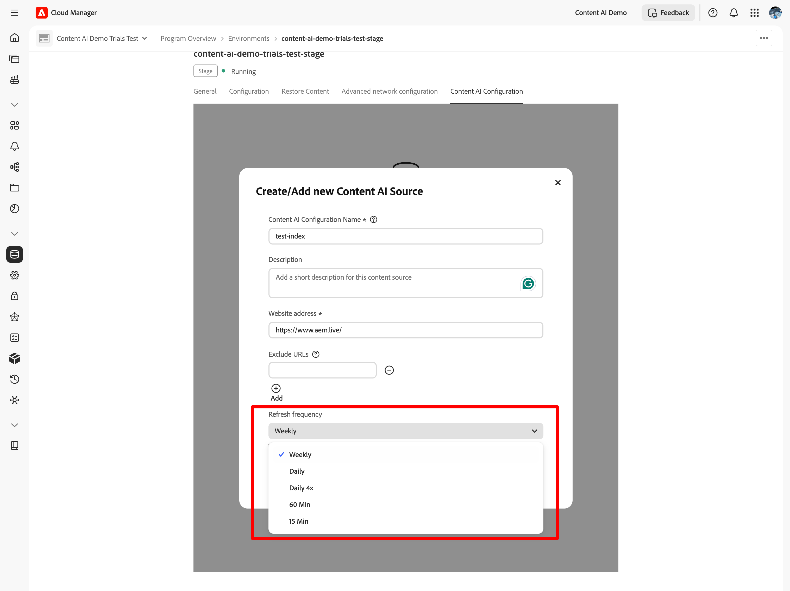

1. Select **[!UICONTROL Create Source]**. Acquisition starts automatically, and the source moves to **Indexing**.

   

## Step 3 - Re-run Acquisition {#trigger-acquisition}

Acquisition runs automatically when you create a source and then on the schedule set by the **[!UICONTROL Refresh frequency]**. You can also trigger a run manually at any time - for example, to re-index immediately after publishing new content.

1. In the source list, select the **more actions** (…) icon next to your source, then select **[!UICONTROL Trigger acquisition]**.

   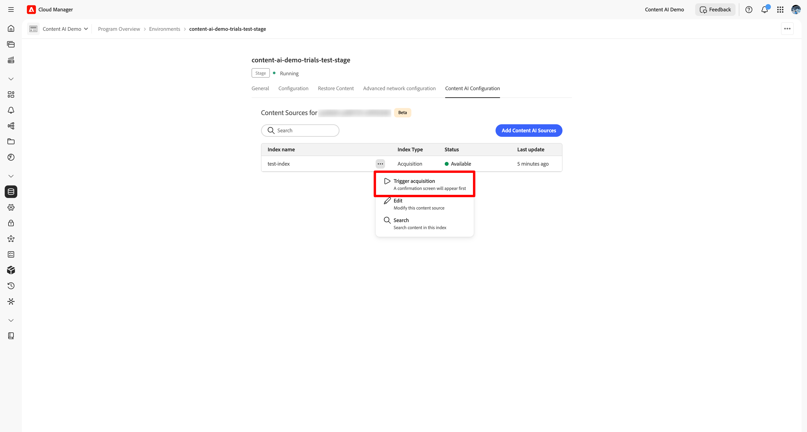

1. In the **[!UICONTROL Trigger Acquisition]** dialog, review the source details - **[!UICONTROL Content source]**, **[!UICONTROL Last run]**, and **[!UICONTROL Next scheduled run]** - and select **[!UICONTROL Trigger]**.

   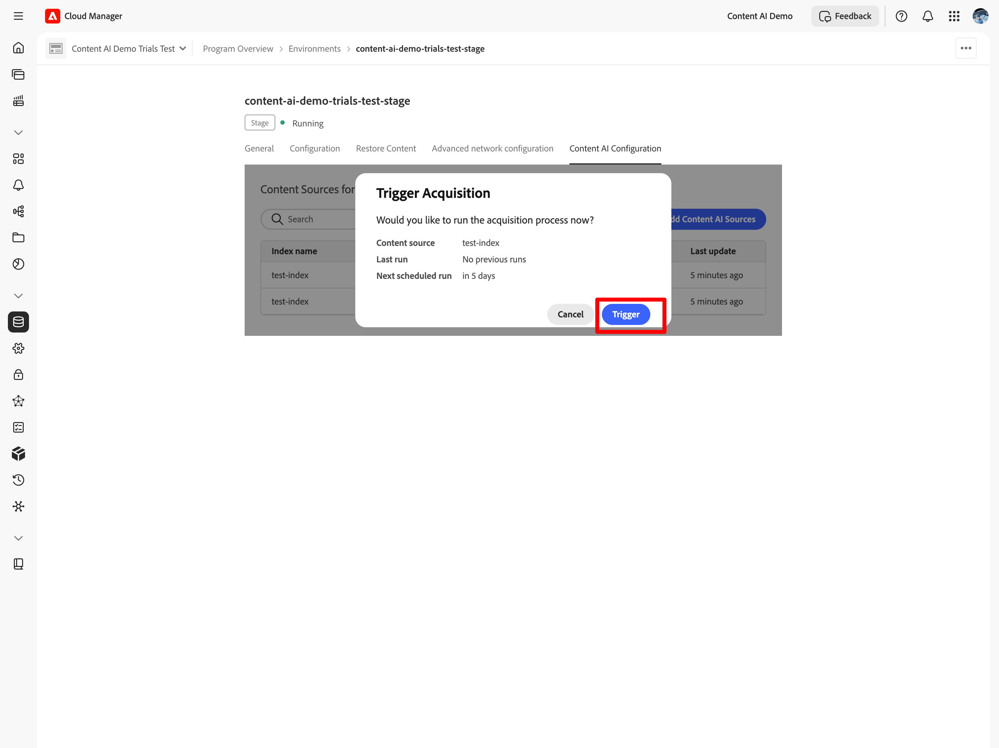

## Step 4 - Monitor Indexing Status {#monitor-status}

After acquisition starts, the source status updates in real time.

| Status | Meaning |
| --- | --- |
| **New** | Source just created; the automatic acquisition has not started yet. This status is brief. |
| **Indexing** | Acquisition is in progress; content is being crawled and indexed. |
| **Available** | Indexing is complete; the source is ready to serve search queries. |

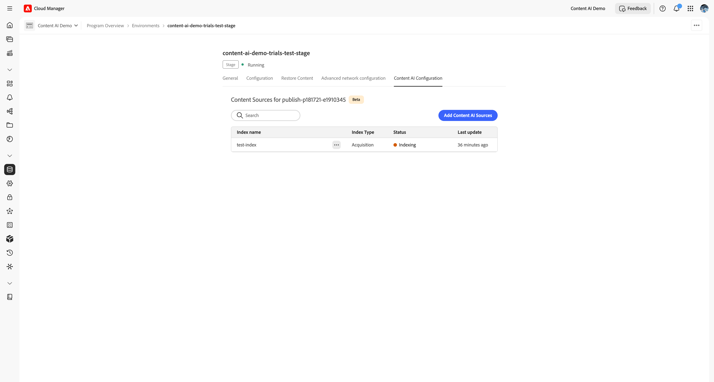

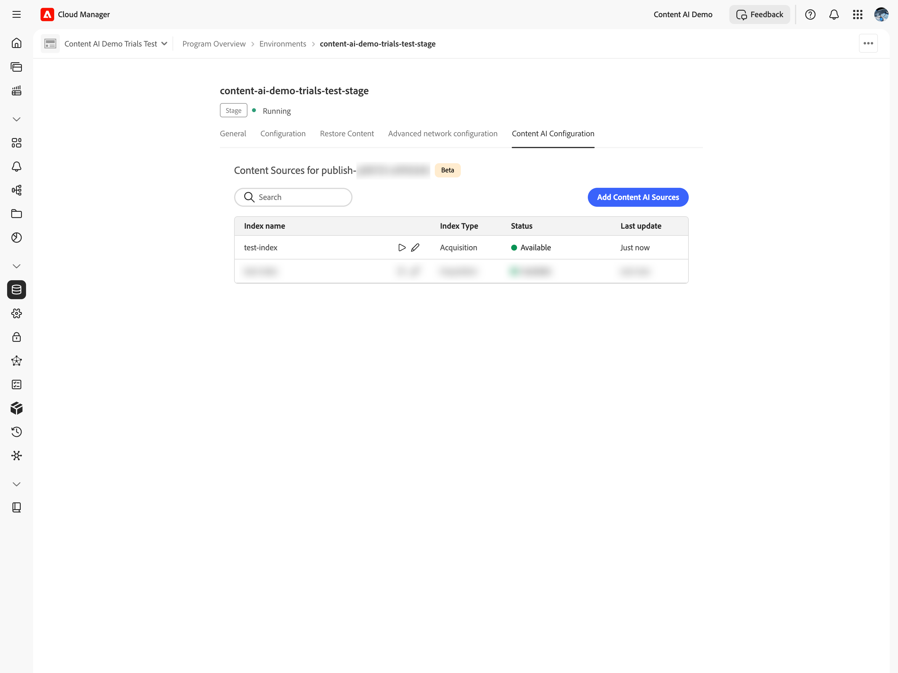

Wait for the status to reach **Available** before searching the index or testing the API.

## Step 5 - Search Indexed Content {#search-content}

Once the source status is **Available**, you can run search queries directly from Cloud Manager to verify that content has been indexed correctly.

1. In the source list, select the **search** (magnifying glass) icon next to your source.

   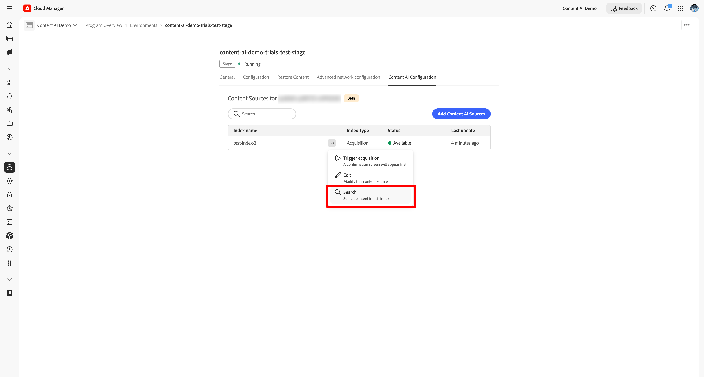

1. Enter a query in the search field. Results show a list of matching items with a match score and content type (for example, **PAGE** or **PDF**). Selecting a result opens a preview on the right.

   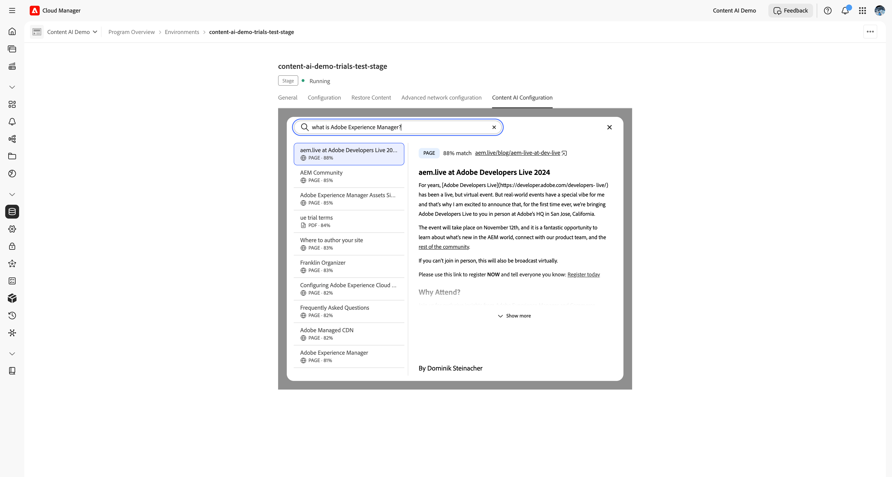

## Modify or Delete a Source {#modify-source}

### Modify a source {#modify}

To update a source configuration after it has been created:

1. In the source list, select the **more actions** (…) icon next to the source, then select **[!UICONTROL Edit]**.

   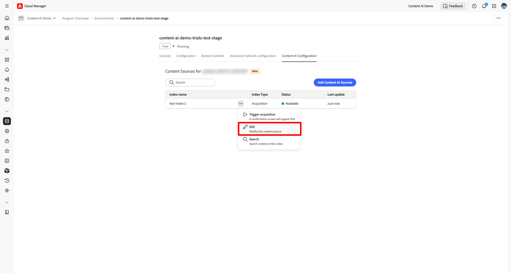

1. In the **[!UICONTROL Modify Content AI Source]** dialog, update the **[!UICONTROL Description]**, **[!UICONTROL Website address]**, **[!UICONTROL Exclude URLs]**, or **[!UICONTROL Refresh frequency]** as needed. The **[!UICONTROL Content AI Configuration Name]** is read-only and cannot be changed.

   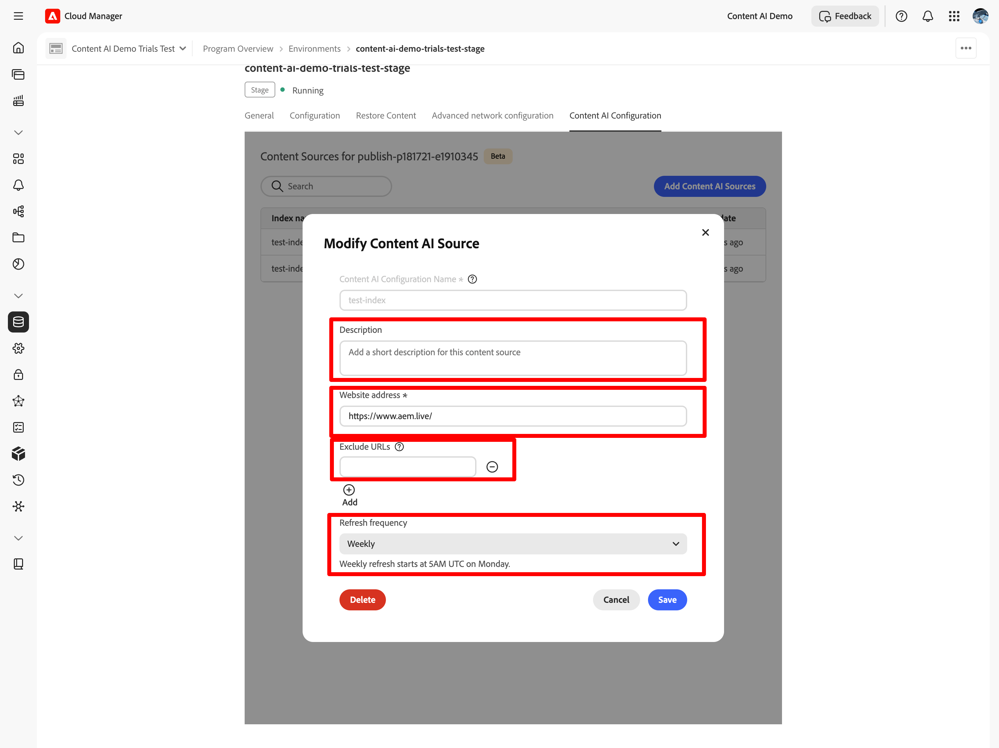

1. Select **[!UICONTROL Save]** to apply the changes. The source list updates to reflect your changes.

### Delete a source {#delete}

1. In the source list, select the **more actions** (…) icon next to the source, then select **[!UICONTROL Delete]**.

   >[!WARNING]
   >
   >Deleting a source is permanent. All indexed content for that source is removed and can no longer serve search queries.

After deletion, the source no longer appears in the list.

## Next Steps {#next-steps}

* [Set Up an Adobe Developer Console Project](setup-adc-project.md) - Create the ADC project and credentials you need to call the API.
* [Content AI API reference](https://developer.adobe.com/experience-cloud/experience-manager-apis/api/experimental/contentai/) - Query your indexed content using semantic, fulltext, or hybrid search endpoints.

## Troubleshooting {#troubleshooting}

* **Source stays in [!UICONTROL Indexing] for an extended period.** Retry the acquisition from the (…) menu. If the status does not advance after a second run, verify that the **[!UICONTROL Website address]** is publicly reachable and that the **[!UICONTROL Exclude URLs]** patterns do not filter out every page.
* **Source moves back to [!UICONTROL New] after a run.** The crawler could not fetch any pages from the configured root URL. Confirm the URL responds with `200 OK` and that the site is not blocking automated requests.
* **[!UICONTROL Search] returns no results for an [!UICONTROL Available] source.** Indexing succeeded, but no content matched the query. Try a broader query or check that the crawled URLs include the pages you expect.
